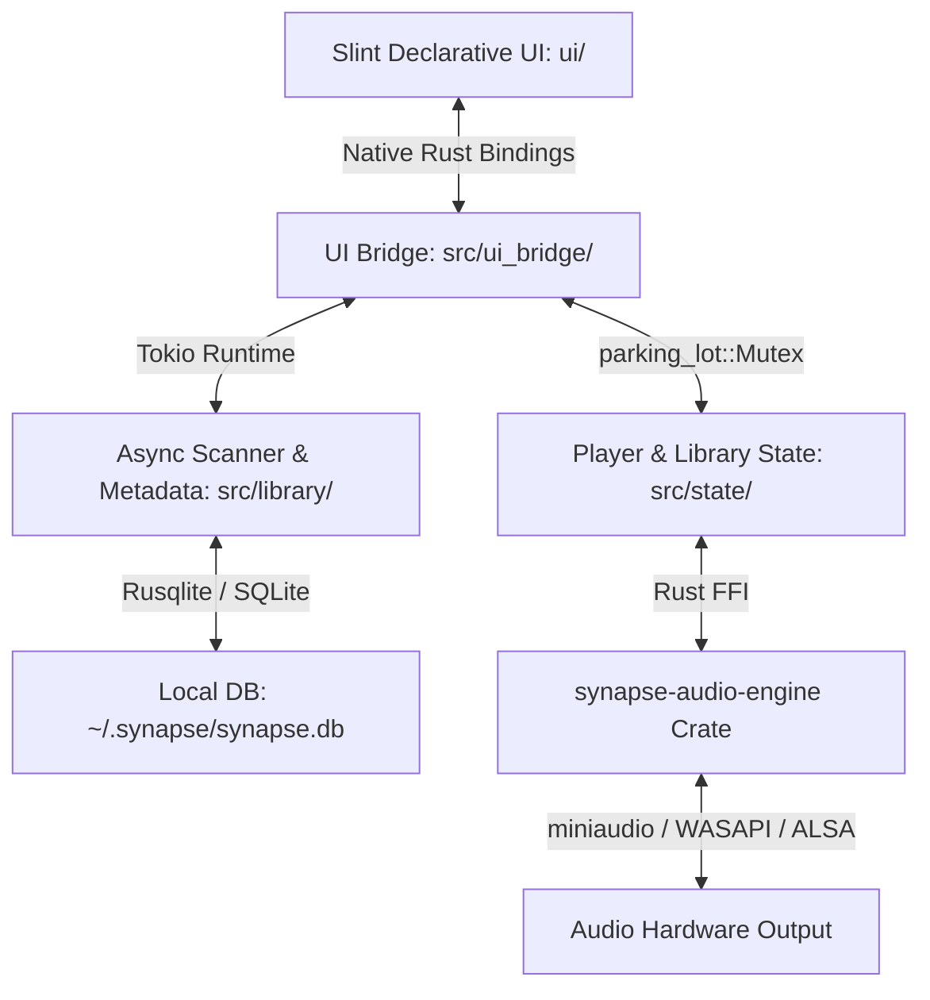

# Synapse Architecture & Design Specification

> [!IMPORTANT]
> **DEVELOPER PROTOCOL**: To inspect the recent modification history and git commit logs of this project, execute:
> `git log -n 10 --oneline`
> Always check the history and `docs/EXPERIENCE.md` before starting tasks to understand the latest state.

---

## 1. System Architecture Diagram

---

## 2. Technical Stack Details

* **Core Language**: Rust (edition 2021)
* **GUI Engine**: Slint 1.8 (`slint` & `slint-build`)
* **Audio Engine**: [`synapse-audio-engine`](https://github.com/T58574/synapse-audio-engine) (C++17 dual-deck DSP engine with miniaudio, ISO 10-band EQ, limiter, stereo widener, reverb, and live 64-band FFT)
* **Database**: SQLite via `rusqlite` (bundled)
* **Metadata Extraction**: `lofty` (ID3v2, Vorbis, FLAC, MP4/AAC tags & cover art)
* **Async Runtime**: `tokio` (multi-threaded background library scanner and cover processor)

---

## 3. Directory Layout

* `src/main.rs`: Application entry point, window bootstrapping, and subsystem initialization.
* `src/ui_bridge/`: Slint callbacks, timers, reactive properties, and visualizer smoothing.
* `src/state/`: `PlayerState`, queue, history, playback controls, and volume/DSP params.
* `src/library/`: SQLite persistence, track scanning, metadata extraction, and playlist CRUD.
* `src/audio/`: Safe high-level Rust wrapper around `synapse-audio-engine` FFI.
* `ui/`: Slint declarative UI files:
  * `ui/main.slint`: Root window layout and navigation.
  * `ui/components/`: Reusable widgets (`button.slint`, `slider.slint`, `icons.slint`, `modal.slint`).
  * `ui/views/`: Primary views (`library_table.slint`, `playback_bar.slint`, `sidebar.slint`, `equalizer.slint`, `settings.slint`, `musicians.slint`).
  * `ui/visualizer/`: Winamp-style silky FFT spectrum visualizer.
* `docs/EXPERIENCE.md`: Persistent repository of real-world bugs, fixes, and lessons learned.

---

## 4. Key Developer Commands

* **Build (Release)**: `cargo build --release`
* **Run**: `cargo run --release`
* **Test**: `cargo test --bin synapse`
* **Interactive Console**: `npm run build:menu`
