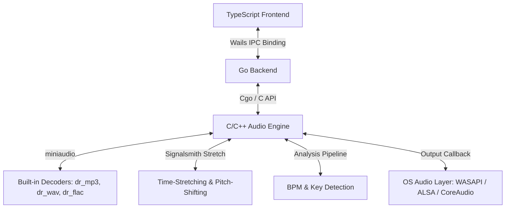

# Synapse Architecture & Design Specification

> [!IMPORTANT]
> **DEVELOPER PROTOCOL**: To inspect the recent modification history and git commit logs of this project, execute:
> `git log -n 10 --oneline`
> Always check the history and `docs/EXPERIENCE.md` before starting tasks to understand the latest state.

---

## 1. System Architecture Diagram



---

## 2. Technical Stack Details

*   **Backend (Go)**: Wails v2 (IPC bridging/binding) + Cgo (low-latency wrapper for C++).
*   **Audio Engine (C/C++)**: Header-only `miniaudio.h` (handles multi-channel I/O and decoders) + `Signalsmith Stretch` (high-quality pitch/time stretching).
*   **Frontend (TypeScript)**: React, CSS custom theme engine, dynamic WebGL liquid wave visualizer.

---

## 3. Data Flow & Processing Pipeline

### 3.1 Audio Analysis Pipeline
1. **Decode**: PCM extraction via miniaudio decoders.
2. **Peaks**: Root-Mean-Square (RMS) peak calculation for waveform rendering.
3. **BPM**: Autocorrelation of middle 30 seconds of signal downsampled to 200Hz (range 60-180 BPM).
4. **Key**: FFT mapping to 12-dimensional pitch-class chroma, correlated with Krumhansl-Schmuckler profiles. Key outputs use Camelot Wheel signatures (e.g. `8A`, `8B`).

### 3.2 Automix Transition Engine
When transition triggers at the end of Track A:
1. **Beat-Aligned Duration**: Crossfade duration ($T_{\text{fade}}$) is aligned to track bars:
   $$T_{\text{fade}} = \text{round}\left(\frac{C \cdot \text{BPM}_A}{240.0}\right) \cdot \frac{240.0}{\text{BPM}_A}$$
2. **Dynamic BPM Sync**: Tempo of Track A is continuously ramped to match Track B:
   $$\text{tempo\_ratio}_A(t) = 1.0 \cdot (1 - t) + \frac{\text{BPM}_B}{\text{BPM}_A} \cdot t$$
3. **Equal-Power Crossfade**:
   $$\text{vol}_A(t) = \cos\left(t \cdot \frac{\pi}{2}\right), \quad \text{vol}_B(t) = \sin\left(t \cdot \frac{\pi}{2}\right)$$

---

## 4. Critical Design & Architectural Constraints

### 4.1 Track Seeking & Drag Stability
* **Mutex & State separation**: Seek updates read from `dragPositionRef.current` synchronously to prevent async React re-render conflicts. Global window listeners for `mouseup` and `touchend` ensure the drag state is cleared if the mouse leaves the window boundaries.

### 4.2 Audio Stutter & Thread Synchronization
* **Continuous Stretching**: To avoid latency switching between fast/slow playback paths, the stretching pipeline is warm and active from start whenever Auto-Mix is enabled.
* **Non-Blocking Metadata Scanning**: C++ file loading (`load_track`) does not lock the real-time audio thread mutex during long analysis tasks. Wave-peak extraction, BPM, and Key analysis are handled asynchronously in a background Go goroutine, updating state using `SetTrackMetadata` and emitting Wails events.
* **Concurrency Guard**: Folder scans and playlist modifications utilize `sync.Mutex` locks (`scanMu` and `playlistMu`) to prevent race conditions on parallel read/writes.

---

## 5. API Schema & Interface Definitions

### 5.1 Go to Frontend Wails Bindings
```go
type TrackMetadata struct {
	FilePath     string    `json:"filePath"`
	DurationSec  float64   `json:"durationSec"`
	BPM          float64   `json:"bpm"`
	KeySignature string    `json:"keySignature"`
	Waveform     []float32 `json:"waveform"`
	Artist       string    `json:"artist"`
	Genre        string    `json:"genre"`
}

type Playlist struct {
	Name       string   `json:"name"`
	TrackPaths []string `json:"trackPaths"`
}

// Key App Bindings (Go to TS)
func (a *App) LoadTrack(slot int, filePath string) (TrackMetadata, error)
func (a *App) Play(slot int)
func (a *App) Pause(slot int)
func (a *App) Seek(slot int, positionSec float64)
func (a *App) SetVolume(slot int, volume float64)
func (a *App) GetPosition(slot int) float64
func (a *App) IsPlaying(slot int) bool
func (a *App) ToggleAutoMix(enabled bool)
func (a *App) SetCrossfadeDuration(durationSec float64)
func (a *App) ScanMusicDir() ([]TrackMetadata, error)
func (a *App) GetPlaylists() ([]Playlist, error)
func (a *App) CreatePlaylist(name string) error
func (a *App) DeletePlaylist(name string) error
func (a *App) AddTrackToPlaylist(playlistName string, trackPath string) error
func (a *App) RemoveTrackFromPlaylist(playlistName string, trackPath string) error
func (a *App) GetAudioDevices() ([]AudioDevice, error)
func (a *App) SetAudioDevice(deviceID string) error
```

### 5.2 Real-Time IPC Events
* **`spectrum`**: Real-time 64-band frequency spectrum emitted at 60 FPS: `{"deck0": [...], "deck1": [...]}`.
* **`track_analyzed`**: Dispatched by the Go background worker when async analysis completes.

---

## 6. WebGL Fluid Visualizer & Mood Classification

* **Mood Engine**: Determines track color aura using `DetermineMood(bpm, key, genre)`.
* **Track Hashing**: Dynamic color palettes (4-color HSL) generated deterministically using a string hash of the track's local `filePath`.
* **Rendering Loop**: Throttled to 30 FPS, canvas downsampled by 3x (rendered via bilinear CSS stretch) to reduce CPU/GPU overhead. Space-warping uses momentum-based phase integration for smooth animations.

