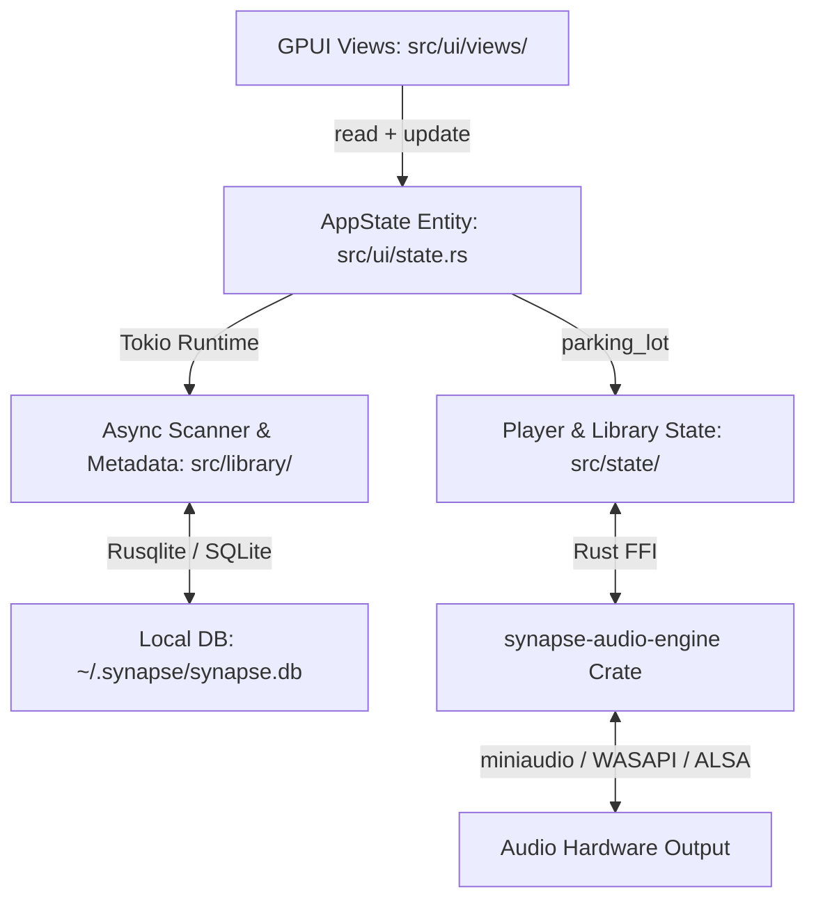

# Synapse Architecture & Design Specification

> [!IMPORTANT]
> **DEVELOPER PROTOCOL**: To inspect the recent modification history and git commit logs of this project, execute:
> `git log -n 10 --oneline`
> Always check the history and `docs/EXPERIENCE.md` before starting tasks to understand the latest state.

---

## 1. System Architecture Diagram

Data flow: views never mutate playback or the library directly. They call `AppState`
methods (`play_index`, `seek`, `set_eq_band`, `scan_directory`, …), which mutate the
domain state and persist settings. A single ticker (33 ms playing / 250 ms idle)
calls `cx.notify()` only when a value actually changed, so idle repaints cost nothing.

---

## 2. Technical Stack Details

| Component | Version | Notes |
|---|---|---|
| Rust | edition 2021, stable toolchain | CI uses current stable |
| GPUI Kit | `=0.9.0` | **only** GPUI entry point; re-exports GPUI, base, component, assets |
| gpui-pre (transitive) | 0.3.11 | pinned by gpui-kit; do **not** add `gpui` from crates.io |
| gpui-component (transitive) | 0.9.0 | buttons, sliders, inputs, theme |
| synapse-audio-engine | git `T58574/synapse-audio-engine` | C++17 dual-deck DSP: EQ, limiter, widener, reverb, 64-band FFT |
| rusqlite | 0.31 (bundled) | SQLite persistence |
| lofty | 0.21 | tag + cover extraction |
| tokio | 1.x (rt-multi-thread, 2 workers, 1 MB stacks) | background scan/cover work |
| rfd | 0.15 | native folder picker |

Version check date: **2026-11-06**.

Hard rule: import GPUI only as `use gpui_kit::*;` (or `gpui_kit::component::…`).
Adding a direct `gpui` dependency breaks type identity with the kit components.

---

## 3. Directory Layout

* `src/main.rs`: `gpui_kit::application().with_assets(AllAssets)` → `gpui_kit::init` → `ui::init`.
* `src/ui/mod.rs`: window options and boot order. **Window opens before `AudioManager::new`** (Windows STA lesson).
* `src/ui/state.rs`: `AppState` — library cache, filter, playback mirror, queue commands, DSP/settings, ticker, worker message channel.
* `src/ui/theme.rs`: neutral dark palette applied to the kit `Theme`, embedded fonts (`assets/fonts/`).
* `src/ui/views/`: `mod.rs` (shell, sliders, nav), `library.rs` (sidebar + virtualized table), `player.rs` (deck + queue panel), `settings.rs`, `equalizer.rs`.
* `src/ui/format.rs`, `src/ui/artists.rs`, `src/ui/shuffle.rs`: pure helpers and Fisher-Yates shuffle deck with unit tests.
* `src/state/`: `PlayerState`, queue, history, playback controls, volume/DSP params.
* `src/library/`: SQLite persistence, track scanning, metadata extraction, playlists.
* `src/audio/`: safe high-level Rust wrapper around `synapse-audio-engine` FFI.
* `src/logger/`: `mod.rs`, `handler.rs`: standard `log` facade, daily file rotation (`~/.synapse/logs`), 7-day retention, and auto-cleanup.
* `assets/fonts/`: Chakra Petch (UI) + JetBrains Mono, embedded via `include_bytes!`.
* `docs/EXPERIENCE.md`: persistent repository of real-world bugs, fixes, and lessons.

---

## 4. Key Developer Commands

* **Build (Release)**: `cargo build --release`
* **Run**: `cargo run --release`
* **Type-check**: `cargo check --all-targets`
* **Lint**: `cargo clippy --all-targets -- -D warnings`
* **Test**: `cargo test --bin synapse`
* **Interactive Console**: `npm run build:menu` (or `npm run check`, `npm run test`, `npm run doctor`)

---

## 5. UI Guidelines

* Plain dark theme only — no cyberpunk chrome, no chamfers, no custom HUD painting.
* Use kit components (`Button`, `Slider`, `Input`, `Icon`) and kit Lucide icons.
* Sliders are owned by `RootView` as `SliderState` entities; the app mirrors state into
  them through `RootView.pending` in `render`, because `set_value` needs `&mut Window`.
* Long lists use `uniform_list` with stable string ids (`format!("track-{index}")`);
  tuple ids do not implement `Into<ElementId>`.
* Scrollable containers need `.id(...)` plus the `InteractiveElement` trait in scope.
